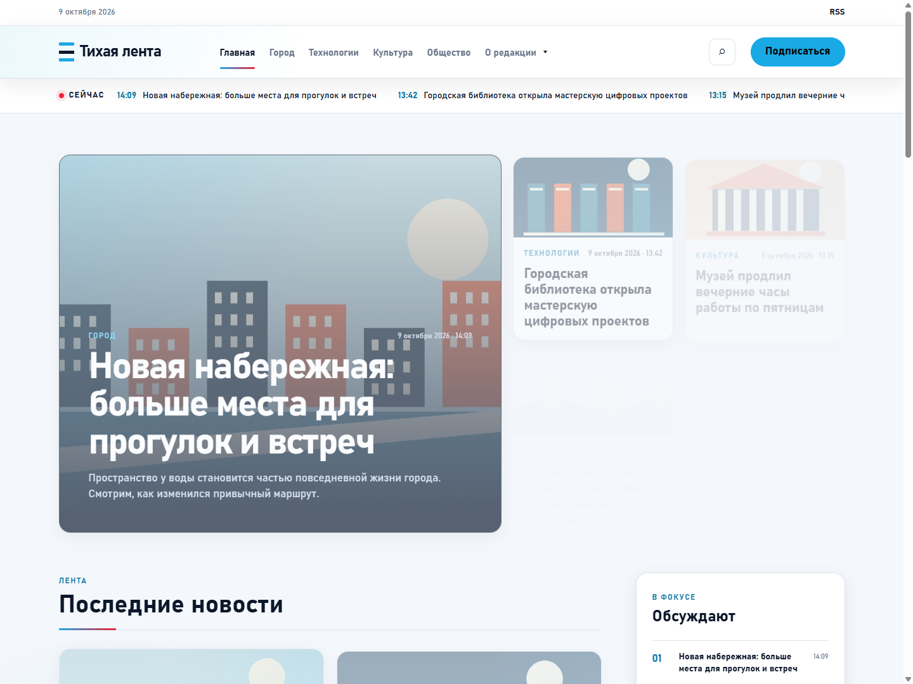
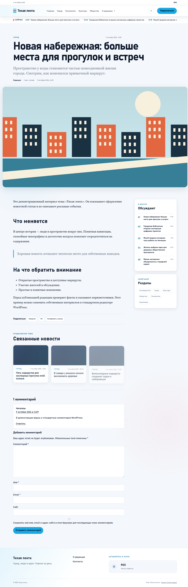
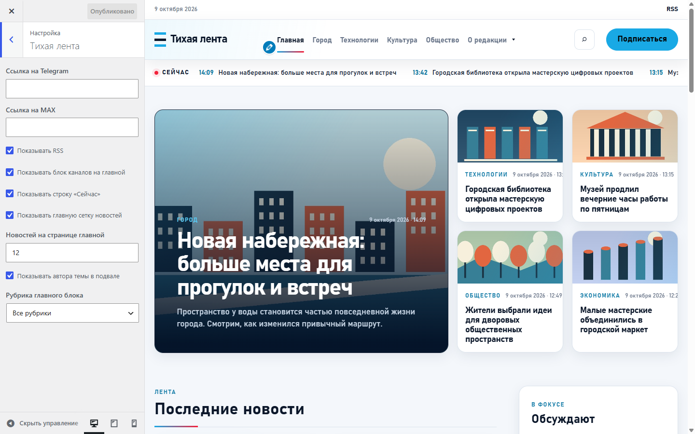
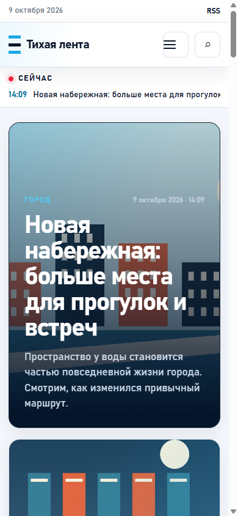
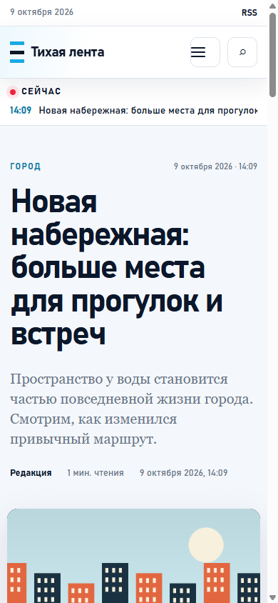

# Тихая лента

Бесплатная тема WordPress для новостных сайтов, городских медиа и авторских журналов. Главные материалы, рубрики и удобное чтение без обязательных плагинов.

**Автор: [Кирилл Александров](https://kodalexandrova.ru)** · **Версия: 1.0.0** · **Лицензия: GPL-2.0-or-later**

[Скачать установочный ZIP](https://github.com/acidtmn/tihaya-lenta/releases/latest) · [Инструкция](readme.txt) · [История изменений](CHANGELOG.md) · [Сообщить об ошибке](https://github.com/acidtmn/tihaya-lenta/issues)



## Возможности

- Новостная главная: ведущие материалы, сетка публикаций, лента «Сейчас» и пагинация.
- Статьи, страницы, архивы рубрик, меток и авторов, поиск и страница 404.
- Стандартные записи, комментарии и редактор блоков WordPress.
- Адаптивное меню с вложенными пунктами, обычный поиск и подсказки при вводе.
- Настройка логотипа, цвета акцента, рубрики главного блока и количества новостей от 6 до 24.
- Необязательные Telegram, MAX и RSS, отключаемая ссылка на автора.
- Работа с клавиатуры: переход к содержимому, управление диалогами и возврат фокуса.
- Системные шрифты, отсутствие встроенных счётчиков и внешних библиотек.

Тема полностью бесплатна. Нет ключей, подписки, платного разблокирования функций и ограничения на число сайтов. Она создана на основе нашей темы проекта [«Новости без шума»](https://novostibezshuma.ru) и отделена от настроек редакции. Демонстрационные новости на снимках вымышлены, геометрические иллюстрации созданы автором.

## Требования

WordPress **6.6+**, PHP **8.2+**. Это классическая PHP-тема с `theme.json`; обязательных плагинов нет. WordPress устанавливается отдельно.

Проверены WordPress 7.0 / PHP 8.2.31 и WordPress 6.6 / PHP 8.3.31. Сценарии и пределы проверки описаны в [отчёте](docs/testing.md).

## Установка

1. Открой [последний релиз](https://github.com/acidtmn/tihaya-lenta/releases/latest) и скачай **`tihaya-lenta-1.0.0.zip`** из раздела Assets.
2. В WordPress перейди в **Внешний вид → Темы → Добавить новую тему → Загрузить тему**.
3. Загрузи ZIP целиком, установи и активируй тему.
4. В **Внешний вид → Настроить** задай название, логотип, цвет и параметры новостной главной.
5. Создай рубрики, добавь записи и назначь меню в **Внешний вид → Меню**.

Установочный файл из Assets содержит папку `tihaya-lenta` с готовой темой. Автоматические архивы GitHub **Source code** и **Code → Download ZIP** содержат также документацию и инструменты разработки; для установки выбирай подготовленный ZIP релиза.

Для ручной установки распакуй установочный ZIP в `wp-content/themes/`: файл `style.css` должен оказаться в `wp-content/themes/tihaya-lenta/style.css`.

## Главная страница и каналы

Для новостной главной выбери **Настройки → Чтение → Ваши последние записи**. Если нужна статическая главная, назначь страницу в этом же разделе: тема покажет её содержимое, а под ним сетку и ленту новостей. Отдельную страницу записей также можно назначить штатно.

Ссылки Telegram и MAX по умолчанию пустые. RSS включён. В настройках темы можно скрыть каналы, главный блок, ленту «Сейчас» и кредит автора. Публикации, рубрики и комментарии добавляются обычными средствами WordPress.

Тема не импортирует новости и не включает базу демонстрационного сайта. Обновления устанавливаются вручную из нового ZIP. Для изменения шаблонов используй дочернюю тему, для небольших изменений оформления - дополнительный CSS. Полная инструкция и ответы на частые вопросы находятся в [readme.txt](readme.txt).

## Снимки

| Статья | Настройки |
| --- | --- |
|  |  |

<details>
<summary>Мобильная главная и статья</summary>

 

</details>

## Разработка и сборка

Корень репозитория является каталогом темы. Для разработки подключи его как `wp-content/themes/tihaya-lenta` к своей тестовой установке WordPress и активируй тему. Публикации и изображения для тестирования добавь на своём стенде.

Собрать установочный ZIP можно в **PowerShell 7+**, без сторонних модулей:

```powershell
pwsh -File ./scripts/build-release.ps1
```

В `dist/` появятся ZIP, файл SHA-256 и манифест. Документация, снимки для GitHub, Git и инструменты сборки в установочный архив не включаются. Версия берётся из `style.css`.

```powershell
Get-FileHash ./dist/tihaya-lenta-1.0.0.zip -Algorithm SHA256
```

Для проверки изменений смотри [CONTRIBUTING.md](CONTRIBUTING.md). Вопросы и воспроизводимые ошибки можно оставлять в [Issues](https://github.com/acidtmn/tihaya-lenta/issues).

## Автор и лицензия

Copyright © 2026 [Кирилл Александров](https://kodalexandrova.ru). Код, оформление и демонстрационные снимки распространяются по **GNU GPL версии 2 или более поздней**. Полный текст - [LICENSE](LICENSE).

Тему можно использовать на коммерческих сайтах, изменять и распространять на условиях GPL. Контент твоего сайта не получает лицензию темы автоматически.
